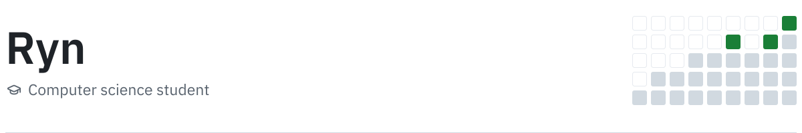
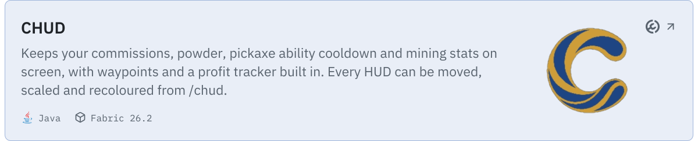
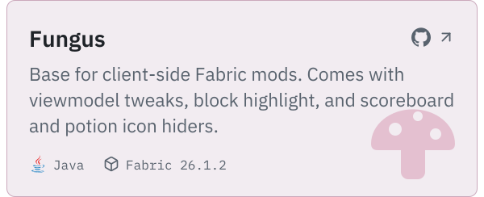
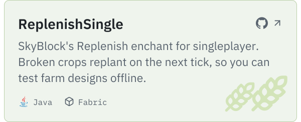
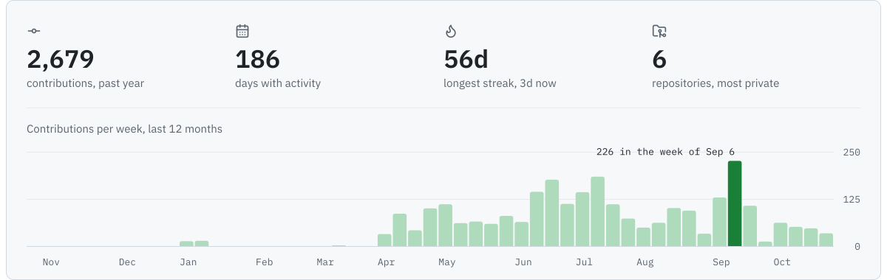
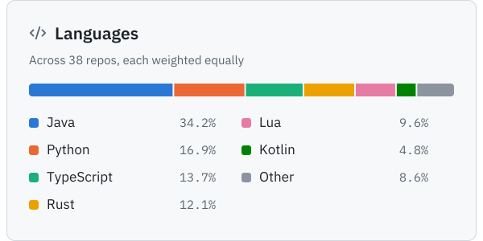
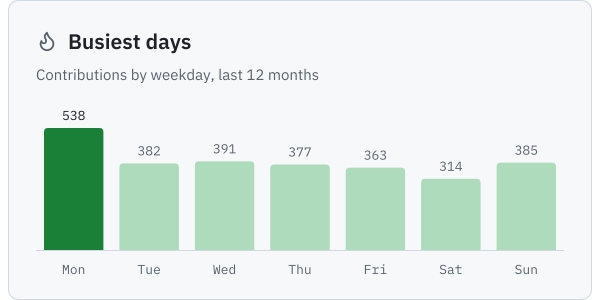

<picture>
  <source media="(prefers-color-scheme: dark)" srcset="assets/header-dark.svg">
  
</picture>

I build client-side Fabric mods, mostly mining and quality-of-life tools for Hypixel SkyBlock.

<a href="https://modrinth.com/mod/chud"><picture><source media="(prefers-color-scheme: dark)" srcset="assets/chud-dark.svg"></picture></a>

<a href="https://github.com/Rynsta/Fungus"><picture><source media="(prefers-color-scheme: dark)" srcset="assets/fungus-dark.svg"></picture></a><a href="https://github.com/Rynsta/ReplenishSingle"><picture><source media="(prefers-color-scheme: dark)" srcset="assets/replenish-dark.svg"></picture></a>

Also on GitHub: [discord-gambler](https://github.com/Rynsta/discord-gambler), a Discord casino bot that runs on fake money.

 

<picture>
  <source media="(prefers-color-scheme: dark)" srcset="assets/activity-dark.svg">
  
</picture>

<picture><source media="(prefers-color-scheme: dark)" srcset="assets/languages-dark.svg"></picture><picture><source media="(prefers-color-scheme: dark)" srcset="assets/weekdays-dark.svg"></picture>

Stats refresh daily and include private repositories.
